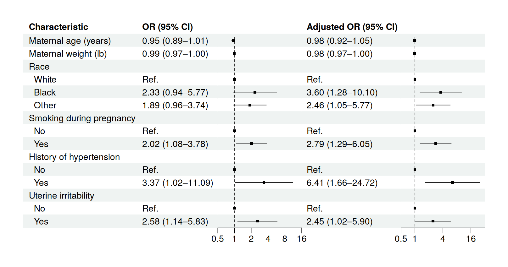
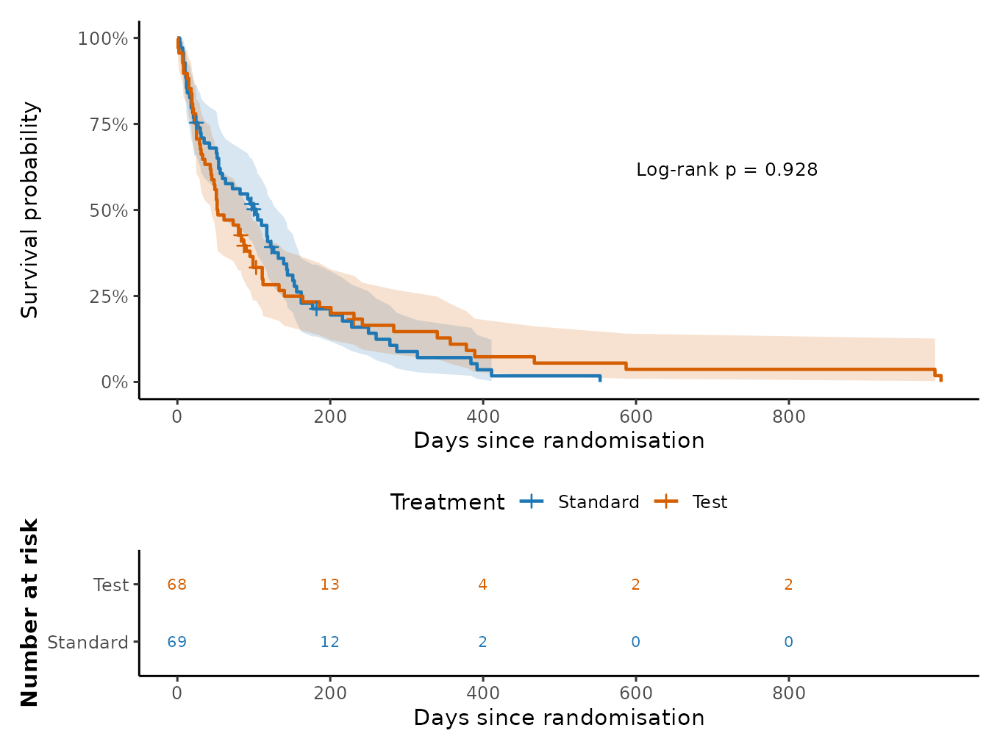
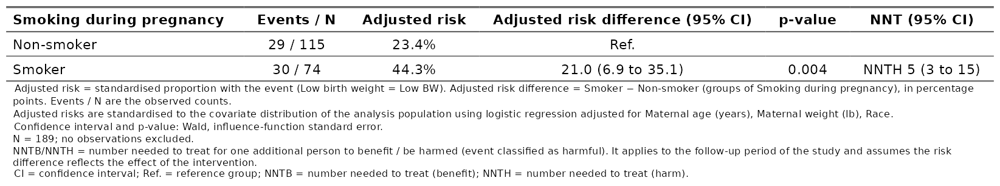

```{r, include = FALSE}
# %\VignetteIndexEntry{Getting Started with gtregression}
# %\VignetteEngine{knitr::rmarkdown}
# %\VignetteEncoding{UTF-8}
```

:::::: gtreg-hero
:::: {}
::: gtreg-kicker
R package for health research
:::

<h1>gtregression</h1>

<p class="gtreg-lead">From model to manuscript. Fit regression and survival
models, and get tables, forest plots and survival curves ready for your paper,
without hand-formatting a single coefficient.</p>

::: gtreg-actions
<a href="https://gtregression.thinkdenominator.com/articles/gtregression-intro.html">Get
started</a><a class="secondary" href="https://gtregression.thinkdenominator.com/articles/choose-model.html">Which
function?</a>
:::

::: gtreg-install
`install.packages("gtregression")`
:::
::::

::: {}

:::
::::::

<!-- badges: start -->

[](https://github.com/ThinkDenominator/gtregression/actions/workflows/R-CMD-check.yaml)
[](https://CRAN.R-project.org/package=gtregression)
[](https://CRAN.R-project.org/package=gtregression)
[](https://app.codecov.io/gh/ThinkDenominator/gtregression)
[](https://lifecycle.r-lib.org/articles/stages.html#stable)
[](https://doi.org/10.5281/zenodo.16905349)

<!-- badges: end -->

## What you can make

<div class="gtreg-gallery">

<a class="gtreg-card" href="https://gtregression.thinkdenominator.com/articles/merge-tables.html">

<span class="gtreg-card-title">Manuscript tables</span>
<span class="gtreg-card-text">Descriptive, crude and adjusted results merged into one table, with every footnote kept.</span>
</a>

<a class="gtreg-card" href="https://gtregression.thinkdenominator.com/articles/visualise-results.html">

<span class="gtreg-card-title">Forest plots</span>
<span class="gtreg-card-text">Crude and adjusted estimates side by side, straight from the fitted models.</span>
</a>

<a class="gtreg-card" href="https://gtregression.thinkdenominator.com/articles/survival-analysis.html">

<span class="gtreg-card-title">Survival analysis</span>
<span class="gtreg-card-text">Kaplan-Meier curves, Cox and parametric models, competing risks and RMST.</span>
</a>

<a class="gtreg-card" href="https://gtregression.thinkdenominator.com/articles/risk-difference.html">

<span class="gtreg-card-title">Absolute effects</span>
<span class="gtreg-card-text">Risk differences and the number needed to treat, crude or adjusted.</span>
</a>

</div>

## New in 1.2.0

<div class="gtreg-new">

<div><strong>Risk difference and NNT</strong>
<span class="gtreg-new-text"><code>risk_difference()</code> reports absolute risks, the risk
difference and NNTB/NNTH, crude or adjusted.</span></div>

<div><strong>More study designs</strong>
<span class="gtreg-new-text">Matched case-control, multilevel, ordinal, multinomial and competing-risk
regression tables.</span></div>

<div><strong>Richer survival tools</strong>
<span class="gtreg-new-text">Proportional-hazards plots, delayed entry, clustering, weights and
adjusted survival curves.</span></div>

<div><strong>Better merging</strong>
<span class="gtreg-new-text">Merge any number of tables, keep each block's notes, and choose a table
theme.</span></div>

</div>

[Read the full list of changes](https://gtregression.thinkdenominator.com/news/index.html).

## From data to manuscript

::::: gtreg-analysis-path
::: gtreg-path-steps
::: gtreg-path-step
<span class="gtreg-path-number">01</span>

::: gtreg-path-copy
**Prepare**

Check variables, labels, levels and missing data.
:::

[`dissect()`]{.gtreg-path-code} <span class="gtreg-path-result">Analysis-ready data</span>
:::

::: gtreg-path-step
<span class="gtreg-path-number">02</span>

::: gtreg-path-copy
**Describe**

Build a clear baseline table before modelling.
:::

[`descriptive_table()`]{.gtreg-path-code} <span class="gtreg-path-result">Table 1</span>
:::

::: gtreg-path-step
<span class="gtreg-path-number">03</span>

::: gtreg-path-copy
**Model**

Fit crude, adjusted, stratified or survival models.
:::

[`uni_reg()` `multi_reg()`]{.gtreg-path-code} <span class="gtreg-path-result">Effect estimates</span>
:::

::: gtreg-path-step
<span class="gtreg-path-number">04</span>

::: gtreg-path-copy
**Interpret**

Check assumptions, confounding, interaction and fit.
:::

[`check_ph()` `compare_models()`]{.gtreg-path-code} <span class="gtreg-path-result">A defensible model</span>
:::

::: gtreg-path-step
<span class="gtreg-path-number">05</span>

::: gtreg-path-copy
**Publish**

Merge, visualise and export.
:::

[`merge_tables()` `save_table()`]{.gtreg-path-code} <span class="gtreg-path-result">Manuscript-ready output</span>
:::
:::
:::::

## A five-minute example

``` r
library(gtregression)
library(dplyr)

data("data_birthwt", package = "gtregression")

birthwt <- data_birthwt |>
  mutate(
    race = factor(race, levels = c(1, 2, 3), labels = c("White", "Black", "Other")),
    smoke = factor(smoke, levels = c(0, 1), labels = c("No", "Yes")),
    ht = factor(ht, levels = c(0, 1), labels = c("No", "Yes")),
    low = factor(low, levels = c(0, 1), labels = c("Normal BW", "Low BW"))
  )

attr(birthwt$smoke, "label") <- "Smoking during pregnancy"
exposures <- c("age", "lwt", "race", "smoke", "ht")

# Baseline characteristics by outcome
desc <- descriptive_table(birthwt, exposures = exposures, by = "low",
                          show_dichotomous = "all_levels")

# One model per exposure, then one adjusted model
crude <- uni_reg(birthwt, outcome = "low", exposures = exposures, approach = "logit")
adjusted <- multi_reg(birthwt, outcome = "low", exposures = exposures, approach = "logit")

# One table for the paper, and a forest plot
table_2 <- merge_tables(desc, crude, adjusted,
                        spanners = c("Low birth weight", "Crude", "Adjusted"))
forest <- forest_reg(forest_df(crude, adjusted))

# Save
save_table(table_2, filename = "table-2", format = "docx")
save_forest(forest, filename = "forest-plot", format = "png")
```

Variable labels set with `attr(x, "label")` or `labelled::var_label()`
appear in every table and plot. Each result keeps its fitted models
(`adjusted$models`) and table data (`adjusted$table_body`), so nothing is
hidden.

## Find your way

<div class="gtreg-tasks">

<a href="https://gtregression.thinkdenominator.com/articles/descriptive-tables.html"><strong>Describe data</strong><span class="gtreg-task-text">Baseline tables with row or column percentages.</span></a>

<a href="https://gtregression.thinkdenominator.com/articles/regression-tables.html"><strong>Regression tables</strong><span class="gtreg-task-text">Logistic, risk ratio, count, linear and Firth models.</span></a>

<a href="https://gtregression.thinkdenominator.com/articles/special-models.html"><strong>Special designs</strong><span class="gtreg-task-text">Matched, multilevel, ordinal, multinomial and competing risks.</span></a>

<a href="https://gtregression.thinkdenominator.com/articles/survival-analysis.html"><strong>Survival analysis</strong><span class="gtreg-task-text">Kaplan-Meier, Cox, parametric models and predictions.</span></a>

<a href="https://gtregression.thinkdenominator.com/articles/risk-difference.html"><strong>Risk difference and NNT</strong><span class="gtreg-task-text">Absolute effects for two-group comparisons.</span></a>

<a href="https://gtregression.thinkdenominator.com/articles/stratified-analysis.html"><strong>Stratified analysis</strong><span class="gtreg-task-text">The same model within each subgroup.</span></a>

<a href="https://gtregression.thinkdenominator.com/articles/confounding-interaction.html"><strong>Confounding and interaction</strong><span class="gtreg-task-text">Screen confounders and test effect modification.</span></a>

<a href="https://gtregression.thinkdenominator.com/articles/causal-mediation.html"><strong>Causal mediation</strong><span class="gtreg-task-text">Direct and indirect effects with clear caveats.</span></a>

<a href="https://gtregression.thinkdenominator.com/articles/diagnostics-selection.html"><strong>Diagnostics</strong><span class="gtreg-task-text">Convergence, collinearity, fit and model comparison.</span></a>

<a href="https://gtregression.thinkdenominator.com/articles/visualise-results.html"><strong>Visualise</strong><span class="gtreg-task-text">Regression plots, forest plots and survival curves.</span></a>

<a href="https://gtregression.thinkdenominator.com/articles/merge-tables.html"><strong>Merge and customise</strong><span class="gtreg-task-text">Combine tables, apply themes, style with flextable.</span></a>

<a href="https://gtregression.thinkdenominator.com/articles/customize-export.html"><strong>Export</strong><span class="gtreg-task-text">Word, HTML, PDF and image output.</span></a>

</div>

## Built on trusted R packages

`gtregression` is a readable interface over established packages: `stats`,
`survival`, `MASS`, `risks` and `logistf` fit the models; `broom`,
`sandwich` and `lmtest` handle inference; `flextable`, `officer` and `gt`
build the tables; `ggplot2`, `patchwork` and `forestploter` draw the figures.
The fitted models stay inside every result, so each number can be traced back
to its source.

## Install

``` r
# CRAN
install.packages("gtregression")

# Development version
remotes::install_github("ThinkDenominator/gtregression")
```

## Citation

If you use `gtregression` in your work, please cite it as:

Polani R, Eliyas SK, Sakthivel M, Kaviprawin M, Krishnamoorthy Y, Majella MG.
*gtregression: Tools for Creating Publication-Ready Regression Tables.*
Zenodo. <https://doi.org/10.5281/zenodo.16905349>
